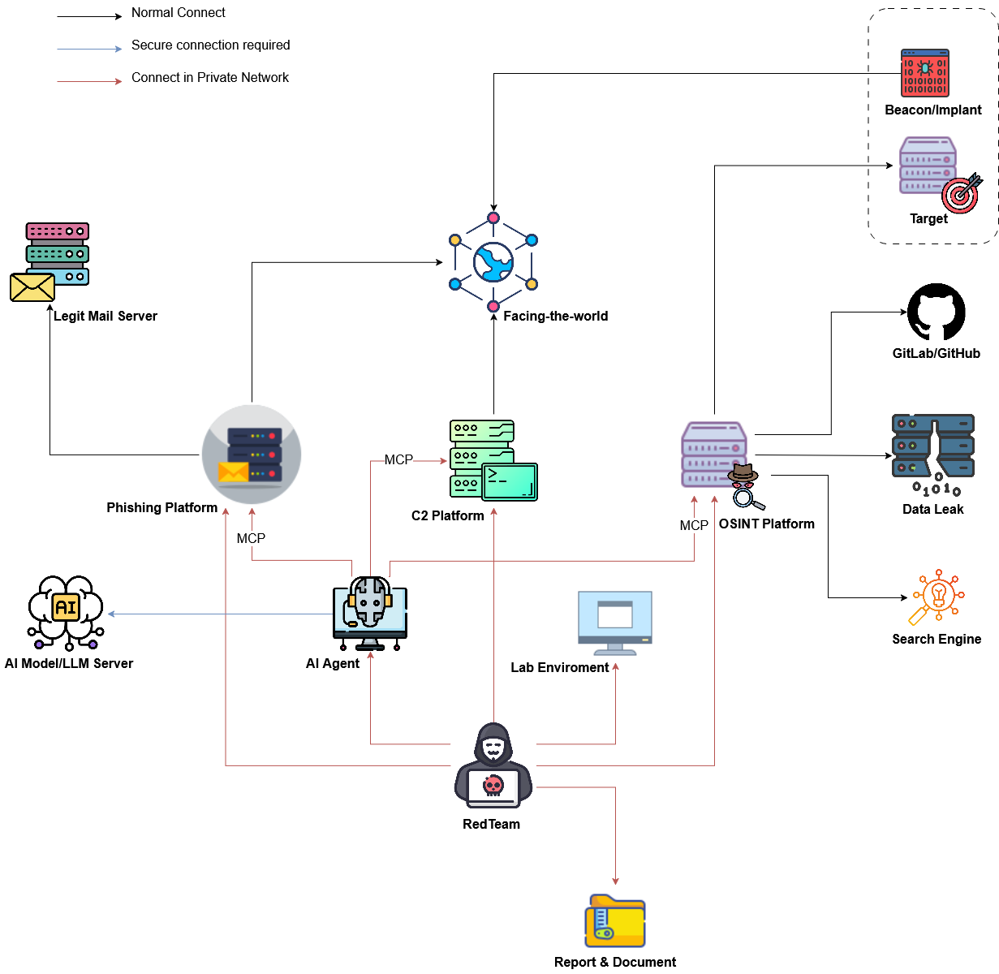

# Modern Red Team Infrastructure

A comprehensive modern architecture model is proposed to integrate platform solutions and tooling to support a professional Red Team.

## Report & Document
This includes referenced documents, workflows, report templates, and tools to support Red Team campaigns in particular and Red Team operations in general.

|Reference|Description|
|---|---|
|[Red Team GitLab Handbook](https://handbook.gitlab.com/handbook/security/security-operations/red-team/)|GitLab's open-source Red Team operations handbook covering methodology, processes, tooling, and best practices for conducting enterprise-level adversarial engagements.|
|[IBM Red teaming](https://www.ibm.com/think/topics/red-teaming)|IBM's overview of red teaming methodology, adversary simulation approaches, and how organizations can leverage offensive security testing to strengthen defenses.|
|[Red Team](https://redteam.io/)|Community-driven platform aggregating red team tools, techniques, resources, and knowledge sharing for offensive security professionals.|
|[VECTR](https://github.com/SecurityRiskAdvisors/VECTR)|Adversary emulation and purple teaming platform by Security Risk Advisors for planning, executing, and tracking red team campaigns — maps TTPs to MITRE ATT&CK, documents detection coverage, and measures security posture improvements over time.|

## RedTeam
Recommended certifications to comprehensively enhance the skills of Red Team members.

|Certificates/Courses|Description|
|---|---|
|[Red Team Ops I & II](https://www.zeropointsecurity.co.uk/course/red-team-ops)|In-depth hands-on course teaching advanced adversary simulation using Cobalt Strike, covering OPSEC-safe tradecraft, lateral movement, privilege escalation, and evasion techniques.|
|[BOF Development & Tradecraft](https://www.zeropointsecurity.co.uk/course/bof-dev)|Specialized course teaching Beacon Object File (BOF) development for Cobalt Strike, enabling custom in-memory capabilities without dropping artifacts to disk.|
|[OSCP+](https://www.offsec.com/courses/pen-200/)|OffSec's foundational penetration testing certification teaching practical exploitation, enumeration, privilege escalation, and report writing through hands-on lab environment.|
|[OSEP](https://www.offsec.com/courses/pen-300/)|Advanced evasion techniques and breaching defenses certification covering AV/EDR bypass, lateral movement in hardened environments, and custom payload development.|
|[OSWE](https://www.offsec.com/courses/web-300/)|Advanced web application security certification focusing on white-box code review, exploiting custom web applications, and developing proof-of-concept exploits.|
|[OSED](https://www.offsec.com/courses/exp-301/)|Windows exploit development certification teaching buffer overflows, shellcoding, reverse engineering, and advanced exploitation techniques on x86 and x64 architectures.|
|[OSEE](https://www.offsec.com/courses/exp-401/)|Expert-level exploit development course covering advanced Windows internals, kernel exploitation, sandbox escapes, and cutting-edge offensive research techniques.|
|[Malware Development Course](https://maldevacademy.com/maldev-course)|Comprehensive course teaching malware creation from scratch using C/C++, covering process injection, EDR evasion, custom loaders, shellcode execution, and obfuscation.|
|[Ransomware Internals, Simulation & Detection Course](https://maldevacademy.com/ransomware-course)|Deep dive into ransomware mechanics, encryption techniques, propagation methods, and how to safely simulate ransomware operations for red team exercises.|
|[Offensive Phishing Operations Course](https://maldevacademy.com/phishing-course)|Practical course on planning and executing sophisticated phishing campaigns, including infrastructure setup, payload development, and credential harvesting techniques.|
|[Modern Initial Access and Evasion Tactics](https://binary-offensive.com/initial-access-training)|Course covering contemporary initial access vectors, living-off-the-land techniques, AMSI/ETW bypasses, and blending into target environments undetected.|
|[Red Teaming (TryHackMe)](https://tryhackme.com/path/outline/redteaming)|Interactive learning path covering red team fundamentals, network exploitation, Active Directory attacks, C2 frameworks, and adversarial emulation methodologies.|
|[Phishlet Developer Masterclass](https://www.simplerhacking.com/courses/phishlet-creation-masterclass)|Hands-on course teaching how to create custom Evilginx phishlets for various web applications to bypass MFA through man-in-the-middle session hijacking.|
|[EvilGoPhish Mastery](https://www.simplerhacking.com/courses/evilgophish-masterclass-course)|Complete guide to deploying and operating EvilGoPhish combining GoPhish's campaign management with Evilginx's MFA bypass capabilities.|
|[Evilginx Professional Masterclass](https://www.simplerhacking.com/courses/evilginx-course)|Professional-level course on Evilginx deployment, infrastructure hardening, phishlet customization, and executing advanced credential harvesting operations.|

## AI Agent
AI agents are recommended to assist humans in the red team campaign deployment process. AI Agents can interact with other components via MCP. *However, we must still emphasize the importance of human decision-making and accountability.*

|AI Agent/MCP App/Rules|Description|
|---|---|
|[Cursor](https://cursor.com/)|AI-powered code editor that provides contextual code generation, intelligent autocomplete, and natural-language editing to accelerate exploit and tool development.|
|[Claude](https://claude.ai)|Anthropic’s advanced AI assistant designed for safe, helpful, and reliable assistance, capable of code analysis, explanation, threat modeling, and documentation.|
|[Windsurf](https://windsurfrs.com/)|AI coding assistant offering full-repository understanding, intelligent code completion, AI pair-programming chat, and enterprise-grade security to boost developer productivity.|
|[Antigravity](https://antigravity.ai/)|AI agent specialized in software development workflows, offering intelligent code completion, refactoring suggestions, and automated testing capabilities.|
|[Continue.dev](https://continue.dev/)|Open-source AI code assistant supporting multiple LLMs, providing autocomplete, code explanations, and customizable prompts directly within the IDE.|
|[HexStrike AI](https://github.com/0x4m4/hexstrike-ai)|Advanced MCP server that enables AI agents (Claude, GPT, Copilot, etc.) to autonomously run over 150 cybersecurity tools for automated pentesting, vulnerability discovery, bug‑bounty automation, and security research, bridging LLMs with real‑world offensive capabilities.|
|[Cursor Best Practices](https://github.com/digitalchild/cursor-best-practices)|Repository of best‑practice guidelines and rules for using Cursor to maximize code generation, refactoring, and automated testing efficiency.|
|[awesome-cursorrules](https://github.com/PatrickJS/awesome-cursorrules)|Curated collection of useful Cursor rules for code generation, refactoring, and testing.|
|[Shannon](https://github.com/KeygraphHQ/shannon)|Fully autonomous AI pentester that discovers real exploits in web applications, achieving a 96.15 % success rate on the hint‑free XBOW benchmark; it automates scanning, vulnerability identification, and exploit generation.|
|[Darkmoon](https://github.com/ASCIT31/Dark-Moon)|Open source (GPL-3.0) autonomous AI red team agent covering web, API, Active Directory and Kubernetes, usable as an MCP host for agent driven operations.|
|[CS-MCP](https://github.com/ibaiC/CS-MCP)|MCP server implementation for Cobalt Strike (based on version 4.12), providing a programmable interface to control Cobalt Strike via the MCP protocol for automation and AI‑agent integration.|
|[Malicious Machine Learning Models - Moltroad](https://moltroad.com/listing/25ca9410-15d2-4af4-801a-ef8821107970)|Poisoned pretrained models. Subtle backdoors, gradient attacks, adversarial triggers. Deploy and watch systems compromise themselves. Perfect for supply chain infiltration.|
|[raptor](https://github.com/gadievron/raptor)|Raptor turns Claude Code into a general-purpose AI offensive/defensive security agent. By using Claude.md and creating rules, sub-agents, and skills, and orchestrating security tool usage, we configure the agent for adversarial thinking, and perform research or attack/defense operations.|
|[ars0n-framework-v2](https://github.com/R-s0n/ars0n-framework-v2)|Modular bug bounty framework wrapping 50+ open-source security tools (Amass, Subfinder, Nuclei, Katana, sqlmap...) in Docker containers, enforcing a structured recon methodology with centralized scan data; ships an MCP server exposing 157 tools for AI-assisted recon, triage, and vulnerability scanning.|
|[pentagi](https://github.com/vxcontrol/pentagi)|Fully autonomous AI Agents system capable of performing complex penetration testing tasks |
|[strix](https://github.com/usestrix/strix)|Open-source autonomous AI pentesting agents that find and fix vulnerabilities — recon, exploitation, and real PoC validation with multi-agent orchestration; developer-first CLI, auto-fix patches, compliance-ready reports, and CI/CD integration (GitHub Actions). Runs locally with Docker plus your own LLM key, or via Strix Cloud.|
|[dreadnode](https://dreadnode.io/)|Dreadnode is a terminal-native platform for building, evaluating, and deploying offensive security agents. |
|[claude-evidence](https://github.com/dn9uy3n/claude-evidence)|AI-powered evidence capture and documentation framework for automated security testing and red team operations tracking.|
|[Agentic-Bug-Hunter](https://github.com/Awarexone/Agentic-Bug-Hunter)|AI-powered bug bounty hunting toolkit covering recon → vulnerability discovery → validation (7-Question Gate) → submission-ready reporting for HackerOne, Bugcrowd, Intigriti, and Immunefi; works as a standalone CLI, Claude Code plugin, or MCP server with 9 specialized agents.|
|[Pentest-Swarm-AI](https://github.com/Armur-Ai/Pentest-Swarm-AI)|Open-source, self-hosted autonomous pentester built on a real swarm architecture — dozens of AI agents coordinate via a stigmergic blackboard to recon, classify, exploit, and report; chains attacks (BOLA/IDOR, JWT forgery, SSRF, SQLi, mass assignment) and proves vulnerabilities with captured evidence. Bring your own model (Claude, OpenAI-compatible, Ollama/LM Studio) and the ProjectDiscovery toolchain.|
|[BreachWeave](https://github.com/m-sec-org/BreachWeave)|Multi-agent collaborative pentest architecture with Manager / Solver / Observer roles: the Manager orchestrates, parallel Solvers explore different attack paths, and an Observer supervises and corrects course; layered Idea/Memory state, context compression, and a dedicated pentest branch for authorized engagements (1st place, Tencent Cloud Intelligent Pentest Hackathon).|
|[ARTEX](https://github.com/mhtsec/ARTEX)|Autonomous AI pentest orchestration system (Go + Next.js + PostgreSQL) with Planner/Worker agents, dual asset/exploration graphs for long engagements, and human-in-the-loop approval gates; bring your own LLM key (Claude, GPT, DeepSeek). Winner of Baidu’s agent+ challenge; original repo went closed-source — this is the community backup of the last open-source release.|
|[CyberStrikeAI](https://github.com/aipentest/cyberstrikeai)|AI-native security operations platform in Go: Eino-powered agents with Deep/Plan-Execute/Supervisor multi-agent modes, graph workflows, 100+ curated tool recipes via MCP, RAG knowledge base, and governance features (RBAC, audit logs, human-in-the-loop approvals); includes built-in C2 and WebShell management for authorized operations.|
|[PentestGPT](https://github.com/Greydgl/PentestGPT)|Automated penetration testing agentic framework (USENIX Security 2024) — multi-stage pipeline (recon → exploit → walkthrough for CTF; asset discovery → vulnerability identification → report for pentests) that drives Claude Code or Codex autonomously; preserves the interactive human-in-the-loop legacy mode with a Pentesting Task Tree across many LLM providers.|
|[Hermes Agent](https://github.com/nousresearch/hermes-agent)|Self-improving general-purpose AI agent by Nous Research with a closed learning loop: creates and refines skills from experience, persistent cross-session memory, scheduled cron automations, subagent delegation, and a messaging gateway (Telegram, Discord, Slack...); works with any model/provider, runs locally or on remote terminal backends (SSH, Docker, Modal, Vercel Sandbox).|
|[triad](https://github.com/squiddyv1/triad)|Engagement driver that chains two AI layers: Strix scans inside a Docker sandbox (no credentials), then Triad hands each finding into Cairn’s Fact/Intent graph as hints and intents for credentialled workers to exploit toward a stated goal; rules-of-engagement contracts, terminal dashboard (Rust TUI), progress telemetry, and report generation. Works standalone or as a Hermes plugin.|

## AI Model/LLM Server

|LLM Server|Description|
|---|---|
|[OpenAI](https://openai.com/)|Leading AI research organization providing GPT models through API for natural language processing, code generation, and complex reasoning tasks.|
|[huggingface](https://huggingface.co/)|Open platform hosting thousands of pre-trained models, datasets, and tools for NLP, computer vision, and machine learning experimentation.|
|[DeepTeam](https://www.trydeepteam.com/)|Open-source AI red teaming framework (by Confident AI) for testing LLM applications against 40+ vulnerability types — jailbreaks, prompt injection, hallucination, bias, PII leakage — with automated attack generation and evaluation reports aligned to OWASP LLM Top 10 and NIST AI RMF.|
|[PentestAgent](https://github.com/0xSojalSec/PentestAgent)|All-in-one AI offensive security assistant with MCP architecture and RAG-based knowledge base; integrates 15+ security tools (Nmap, Metasploit, FFUF, SQLMap, Nuclei) via MCP servers, supports autonomous agent mode with pentesting task trees, predefined workflows, and markdown report generation.|

## Continuous Automated Red Team (CART)
"Continuous automated red teaming (CART) solutions enable organizations to continuously assess security posture in real time. CART solutions use automation to discover assets, prioritize vulnerabilities and conduct attacks using tools and exploits developed and maintained by industry experts." - IBM Red teaming

|CART|Description|
|---|---|
|[rengine](https://github.com/yogeshojha/rengine)|Automated reconnaissance framework with GPT-powered vulnerability analysis, continuous monitoring, subdomain discovery, endpoint extraction, and comprehensive reporting.|
|[bbot](https://github.com/blacklanternsecurity/bbot)|Recursive OSINT automation tool finding 20-50% more subdomains through AI/NLP-powered mutations, passive API enumeration, and intelligent DNS brute-forcing.|
|[flowsint](https://github.com/reconurge/flowsint)|Self-hosted, graph-based OSINT investigation platform: explore relationships between domains, IPs, people, emails, and crypto wallets through automated enrichers (subdomain discovery, WHOIS, breach checks, Maigret username search) on a Neo4j graph with privacy-first local storage.|
|[redamon](https://github.com/samugit83/redamon)|An AI-powered agentic red team framework that automates offensive security operations, from reconnaissance to exploitation to post-exploitation, with zero human intervention.|

## Data Leak

|Data Leak|Description|
|---|---|
|[Group-IB](https://www.group-ib.com/)|Search engine for identifying exposed databases, credentials, and sensitive information from historical breaches for threat intelligence and exposure assessment.|
|[IntelX](https://intelx.io/)|Search engine for identifying exposed databases, credentials, and sensitive information from historical breaches for threat intelligence and exposure assessment.|
|[AK Log query](https://t.me/akquery2020)|Telegram channel for data leak notifications and exposed database intelligence.|
|[Leak Radar](https://t.me/Leakradarcloud_bot?start=ref888771449)|Telegram bot providing real-time alerts on data leaks and exposed credentials from various sources.|

## Search Engine

|Search Engine|Description|
|---|---|
|[Shodan](https://www.shodan.io/)|Internet-wide scanner indexing exposed devices, services, and vulnerabilities across global IP space for attack surface discovery and threat intelligence.|
|[ZoomEye](https://www.zoomeye.ai/)|Cyberspace search engine providing device fingerprinting, service detection, and vulnerability mapping across internet-connected systems.|
|[Censys](https://censys.io/)|Internet scanning platform offering comprehensive visibility into exposed assets, certificates, and infrastructure for attack surface management.|
|[ViewDNS.info](https://viewdns.info/)|Collection of DNS and networking tools providing reverse IP lookup, DNS records, port scanning, and historical DNS data.|
|[DNSDumpster](https://dnsdumpster.com/)|Free domain research tool for discovering DNS records, subdomains, and mapping organizational infrastructure through passive reconnaissance.|
|[Sourcegraph](https://sourcegraph.com/)|Universal code search engine enabling rapid discovery of code patterns, vulnerabilities, and sensitive data across public and private repositories.|
|[Hunter.io](https://hunter.io/)|Email discovery and verification platform for finding corporate email addresses, patterns, and organizational contacts for social engineering research.|

## C2 Platform

|C2 Platform|Description|
|---|---|
|[Cobalt Strike](https://www.cobaltstrike.com/)|Industry-standard commercial C2 framework with malleable profiles, Beacon payload, post-exploitation modules, process injection, and team collaboration for red team operations.|
|[BruteRatel](https://bruteratel.com/)|Advanced C2 framework with userland hook removal, sleep masking, customizable communication channels, and superior EDR evasion designed for professional red teams.|
|[Loki](https://github.com/boku7/Loki)|Lightweight open-source C2 framework emphasizing simplicity and OPSEC-safe design for covert command and control operations. "EDR/AV evasion can be achieved through implantation using a script-jack vulnerability in electron applications."|
|[Sliver](https://github.com/BishopFox/sliver)|Cross-platform open-source C2 by Bishop Fox supporting mTLS/WireGuard/HTTP/DNS, dynamic code generation, multiplayer mode, and compile-time obfuscation.|
|[MythicAgents](https://github.com/MythicAgents/Mythic)|Collaborative multi-platform C2 with plug-and-play agent architecture, containerized microservices, flexible communication profiles, and browser-based team interface.|
|[Havoc](https://github.com/HavocFramework/Havoc)|Modern open-source C2 alternative to Cobalt Strike featuring Demon agents, indirect syscalls, sleep obfuscation, and modular payload design for evasion.|
|[Nimhawk](https://github.com/hdbreaker/Nimhawk)|Stealthy C2 framework written in Nim language offering native speed, small payload sizes, and cross-platform capabilities for red team engagements.|
|[Specter Insight](https://practicalsecurityanalytics.com/specterinsight/)|Commercial cross-platform .NET post-exploitation C2 framework for red team engagements and threat emulation; PowerShell implants with 167 built-in SpecterScripts, payload obfuscation pipelines, AMSI/logging bypass, and ELK integration with pre-built MITRE ATT&CK dashboards.|
|[Adaptix C2](https://github.com/Adaptix-Framework/AdaptixC2)|Open-source, extensible C2 framework with a cross-platform agent (Windows, Linux, macOS), HTTP/S listeners, GUI and console operator clients, .NET in-memory assembly execution, and a community extension ecosystem for custom agents and post-exploitation modules.|
|Sryxen|“A platform developed by EvilByte focuses on exfiltrating data from victim endpoints and evading security controls.”|
|Rust Pulse C2|||
|[Bear C2](https://github.com/S3N4T0R-0X0/BEAR)|Bear C2 is a compilation of C2 scripts, payloads, and stagers used in simulated attacks by Russian APT groups|
|[RTLC2](https://github.com/CyberSecurityUP/RTLC2)|Red Team Lab Command and Control (RTLC2) is a C2 framework that provides a platform for red team operations.|
|[ArachneC2](https://github.com/portbuster1337/ArachneC2)|Advanced C2 framework with sophisticated command and control capabilities for red team operations.|

## Facing-the-world
The isolation layer between the Red Team's sensitive systems and the internet.

|Facing-the-world|Description|
|---|---|
|[BounceBack](https://github.com/D00Movenok/BounceBack)|Highly configurable malleable redirector with embedded WAF functionality — IP/ASN/User-Agent allowlists, malleable C2 profile validation, and domain fronting support to filter malicious traffic and shield C2 infrastructure.|
|[C3](https://github.com/ReversecLabs/C3)|Custom Command and Control framework enabling creation of resilient, decentralized C2 channels through various interconnected relay mechanisms.|
|[Drip](https://github.com/Gouryella/drip)|Self-hosted tunneling solution for exposing local services to the internet through your own domain — unlimited tunnels and bandwidth, bearer-token access control, and per-tunnel QoS bandwidth limiting; useful for exposing redirector or phishing infrastructure without third-party tunneling services.|
|[InfraGuard](https://github.com/Whispergate/InfraGuard)|Infrastructure hardening and protection tool for securing red team facing-the-world components with advanced filtering and threat detection capabilities.|

## Phishing Platform

|Phishing Platform|Description|
|---|---|
|[Evilginx Pro](https://evilginx.com/)|Commercial version of Evilginx offering advanced reverse-proxy phishing with session token stealing to bypass MFA, including premium support and additional features.|
|[Evilginx 3.0](https://github.com/kgretzky/evilginx2)|Open-source man-in-the-middle attack framework transparently proxying authentication flows to capture credentials and session cookies, defeating 2FA/MFA protections.|
|[Gophish](https://getgophish.com/)|Open-source phishing simulation platform with campaign management, email template customization, landing pages, real-time analytics, and REST API for security awareness training.|
|[EvilGoPhish](https://github.com/evilgophish/evilgophish)|Integration combining Gophish's campaign management with Evilginx's MFA bypass capabilities for sophisticated phishing simulations.|
|[GitHubDeviceCodePhishing](https://github.com/Maldev-Academy/GitHubDeviceCodePhishing)|Phishing technique abusing GitHub’s OAuth device code flow: the target is lured into entering an attacker-supplied code on GitHub’s legitimate login page, granting the attacker’s application an access token to the victim’s account.|
|[CamPhish](https://github.com/Mr-Spect3r/CamPhish)|Camera phishing tool that generates a malicious link; when the target opens it and grants camera permission, the tool silently captures snapshots from the victim’s device camera and collects basic device information.|
|[SocialFish](https://github.com/UndeadSec/SocialFish)|Open-source phishing framework for social engineering campaigns with credential harvesting and phishing page creation capabilities.|

## Legit Mail Server
Using Legit Mail servers helps us bypass some automatic email filters, preventing emails from being marked as suspicious or spam.

|Legit Mail Server|Description|
|---|---|
|[GoDaddy Email](https://www.godaddy.com/vi-vn/email)|Professional email hosting service providing legitimate SMTP infrastructure for phishing campaigns requiring reputable sender domains.|
|[Mailgun](https://www.mailgun.com/)|Transactional email API service offering programmatic email delivery, tracking, and delivery optimization for large-scale phishing campaigns.|
|[SendGrid](https://sendgrid.com/)|Cloud-based email delivery platform with high deliverability rates, detailed analytics, and API access for automating phishing operations.|

## Beacon/Implant
These sample code snippets can be used to improve, customize, or even create new malware samples to suit the Red Team campaign.

|Repo/Tool|Description|
|---|---|
|[Rust for malware Development](https://github.com/Whitecat18/Rust-for-Malware-Development)|Educational repository teaching Rust-based implant development leveraging memory safety, low-level control, and cross-compilation for modern red team operations.|
|[ChromElevator (Chrome App-Bound Encryption Decryption)](https://github.com/Whitecat18/ChromElevator)|Tool for bypassing Chrome's App-Bound Encryption to extract cookies, credentials, and sensitive data from Chromium-based browsers for post-exploitation.|
|[EvilBytecode](https://github.com/EvilBytecode)|GitHub collection of malware development PoCs and offensive tooling written in Go, Rust and C++, demonstrating process injection, direct syscalls/NTAPI evasion, payload loaders, and various EDR bypass techniques.|
|[OffensiveCpp](https://github.com/lsecqt/OffensiveCpp)|Curated collection of C++ offensive security projects including process injection, EDR bypass, shellcode loaders, and exploitation techniques.|
|[OffensiveGo](https://github.com/lsecqt/OffensiveGo)|Repository of offensive Golang projects for implant development, infrastructure tooling, and cross-platform exploitation utilities.|
|[OffensiveRust](https://github.com/lsecqt/OffensiveRust)|Collection of Rust-based offensive security tools demonstrating system-level programming for malware development and post-exploitation.|
|[SharpCollection](https://github.com/Flangvik/SharpCollection)|Pre-compiled .NET assembly collection for red team operations including privilege escalation, lateral movement, and Active Directory exploitation.|
|[UnProtect](https://unprotect.it/)|Comprehensive malware evasion techniques database documenting anti-analysis, anti-debugging, and EDR/AV bypass methods with classification and PoCs.|
|[DumpChromeSecrets](https://github.com/Maldev-Academy/DumpChromeSecrets)|Tool for extracting Chrome's App-Bound Encryption to extract cookies, credentials, and sensitive data from Chromium-based browsers for post-exploitation.|
|[Malware Source Code](https://malwaresourcecode.com/)|Personal archive of Windows malware source code snippets and research write-ups (WINAPI-based payloads) maintained by the vx-underground administrator; educational resource pointing to the broader vx-underground source-code collection.|
|[Crystal-Kit](https://github.com/rasta-mouse/Crystal-Kit)|This repo is a technical and social experiment to explore whether replacing Cobalt Strike's evasion primitives (Sleepmask/BeaconGate).|
|[SysWhispers4](https://github.com/JoasASantos/SysWhispers4)|SysWhispers is a tool that generates position-independent shellcode that calls Windows API functions directly, bypassing user-mode hooks and improving EDR evasion.|
|[CrossC2](https://github.com/gloxec/CrossC2)|generate CobaltStrike's cross-platform payload|
|[BinarySpy](https://github.com/yj94/BinarySpy)|A tool for automatic patch shellcode into binary file to bypass AV.|
|[Crystal-Grotto](https://github.com/sliverarmory/crystal-grotto)|Sliver armory repository providing modular beacon and implant enhancements for advanced red team operations.|
|[CloakBrowser](https://github.com/CloakHQ/CloakBrowser)|Browser-based implant delivery and execution framework for seamless code execution within target environments.|
|[OperatorsKit](https://github.com/REDMED-X/OperatorsKit)|Collection of 40+ Beacon Object Files (BOFs) for Cobalt Strike and other C2 frameworks, covering enumeration (security products, exclusions, shares, Sysmon), defense evasion (Defender exclusions, firewall rules, DLL sideloading/hijacking), credential attacks (Kerberoasting, password spraying, NetNTLM capture), and injection (PoolParty via Windows Thread Pools).|
|[Cuban-Eight](https://github.com/shaheeryasirofficial/Cuban-Eight)|WSL distro packager that wraps a Windows PE payload as a double-clickable .wsl file; on launch, Windows registers it as a Linux distro and the payload executes via WSL interop (binfmt_misc) with a minimal ~18KB rootfs and spoofable distro identity (Ubuntu, Kali, Debian...) for stealthy initial access.|

## Lab Environment
After developing a malware sample for the campaign, we need to assess its detectability using static signatures while ensuring that this sample is not recorded on the cloud systems of antivirus solutions.

|Yara Rule|Description|
|---|---|
|[Elastic Protections Artifacts](https://github.com/elastic/protections-artifacts)|Elastic Protections Artifacts is a collection of Yara rules for detecting and identifying malicious artifacts in a lab environment.|
|[Defender Yara](https://github.com/roadwy/DefenderYara)|Defender Yara is a collection of Yara rules for detecting and identifying malicious artifacts in a lab environment.|
